<div align="center">



<br/>

[](https://parsakhosravani.vercel.app)
[](https://www.linkedin.com/in/parsakhosravani/)
[](mailto:parsakhosravani@gmail.com)
[](https://x.com/parsakhosravan1)

</div>

```console
parsa@github:~$ git stats --all
```

<div align="center">


</div>

```console
parsa@github:~$ ./snake --eat contributions
```

<div align="center">

<picture>
  <source media="(prefers-color-scheme: dark)" srcset="https://raw.githubusercontent.com/parsakhosravani/parsakhosravani/output/snake-dark.svg" />
  
</picture>

</div>

<details>
<summary><code>parsa@github:~$ wakatime --this-week</code></summary>

<!--START_SECTION:waka-->
<!--END_SECTION:waka-->

</details>

<div align="center">
<sub><code>exit 0</code> · thanks for stopping by</sub>
</div>
